# GIS Cartography & Remote Sensing Project Gallery

A curated collection of thematic maps, machine learning land-cover classifications, hydrological watershed models, thermal urban heat maps, and georeferenced cartography developed using **Google Earth Engine (JavaScript API)**, **ArcGIS Pro**, and **QGIS**.

---

## 1. Land Use Land Cover (LULC) Mapping of Jashore District
* **Tools & Data:** Google Earth Engine (GEE), QGIS, Cloud-Based Satellite Imagery
* **Summary:** Machine learning supervised classification in GEE with post-processing and cartographic layout design in QGIS.
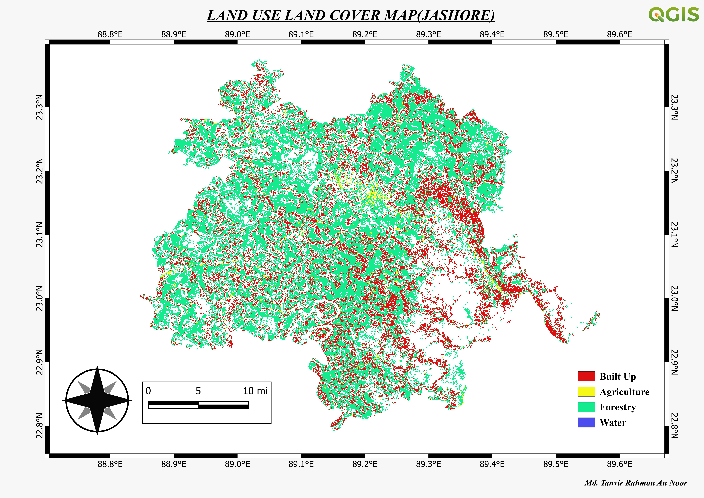

---

## 2. Watershed Delineation & Hydrological Modeling of Khagrachhari
* **Tools & Data:** ArcGIS Pro, 30m SRTM DEM
* **Summary:** Delineated drainage basins and stream networks using Fill, Flow Direction, and Flow Accumulation tools to produce a 3D topographic watershed map.
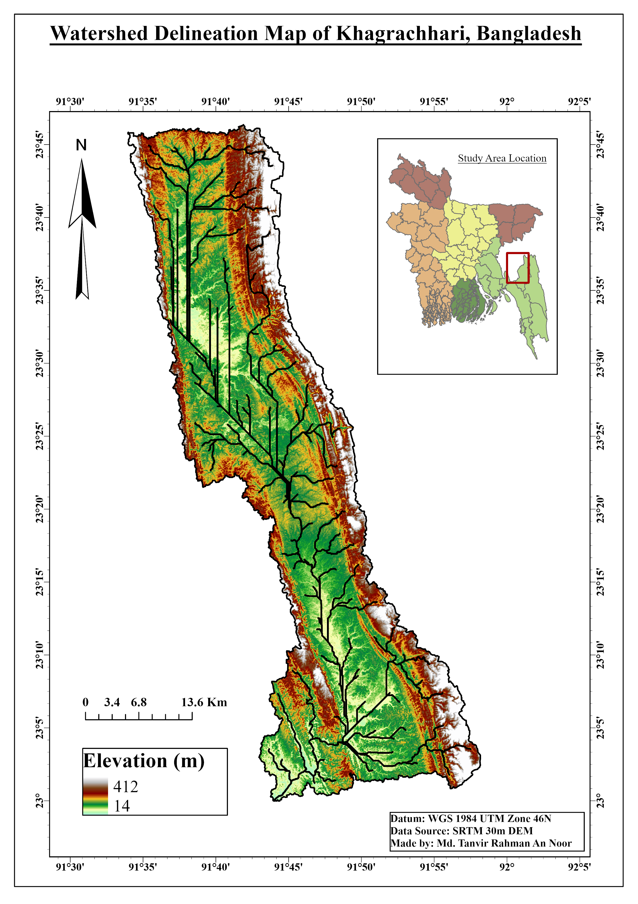

---

## 3. Land Surface Temperature (LST) Mapping of Narayanganj
* **Tools & Data:** ArcGIS Pro, 30m USGS Landsat 9 TIRS-2 Level-2 Imagery
* **Summary:** Classified surface temperatures (23.13°C–46.11°C) into a 5-class thermal map delineating urban and industrial heat hotspots.
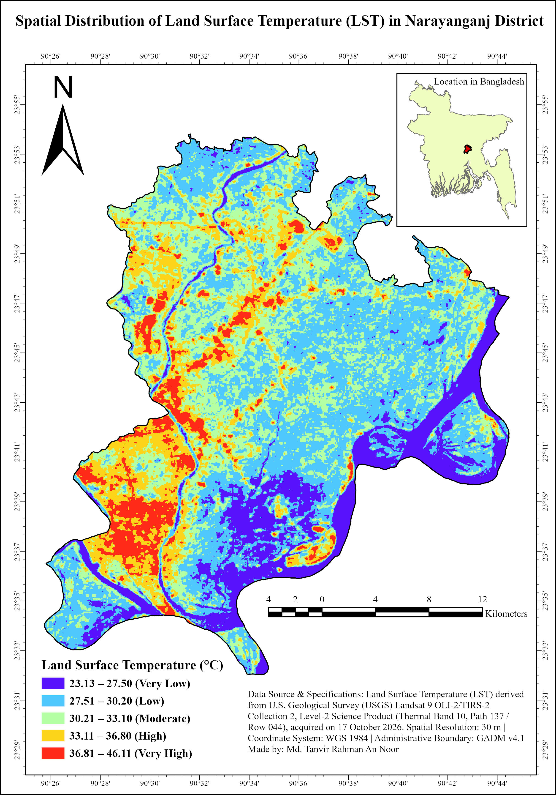

---

## 4. Land Surface Temperature (LST) Mapping of Dhaka
* **Tools & Data:** Google Earth Engine (GEE), QGIS, Multi-Temporal Landsat 8 Imagery
* **Summary:** Extracted NDVI and surface temperature distribution across Dhaka in GEE with thermal visualization in QGIS.
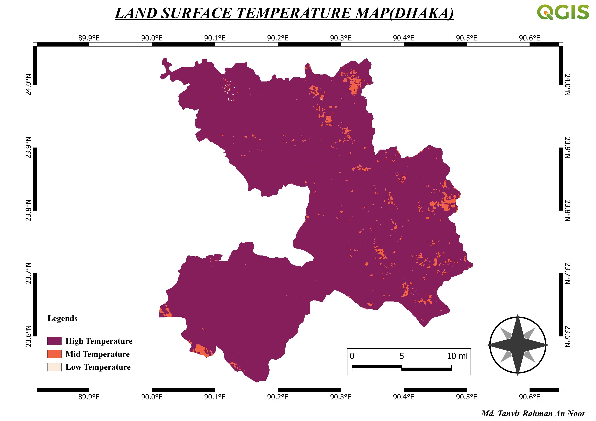

---

## 5. Nighttime Light Expansion: Greater Dhaka–Padma Bridge Corridor (2014–2025)
* **Tools & Data:** Google Earth Engine (GEE), VIIRS DNB & MODIS Land Cover Datasets
* **Summary:** Quantified 106.4%–253.0% Sum of Lights (SOL) radiance growth across urban and agricultural zones between 2014 and 2025.
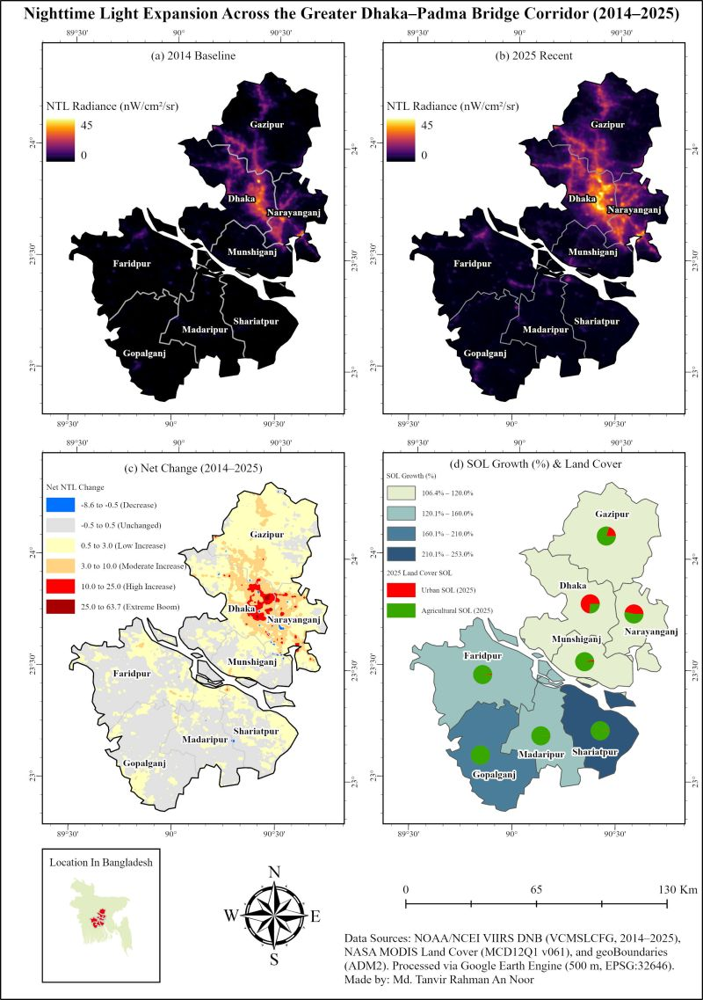

---

## 6. Vegetation Cover Mapping of Kishoreganj District (Jan 2026)
* **Tools & Data:** ArcGIS Pro, USGS Landsat 8 Level-2 Imagery
* **Summary:** Classified regional NDVI values (-0.07 to 0.46) into five ecological zones across Kishoreganj District.
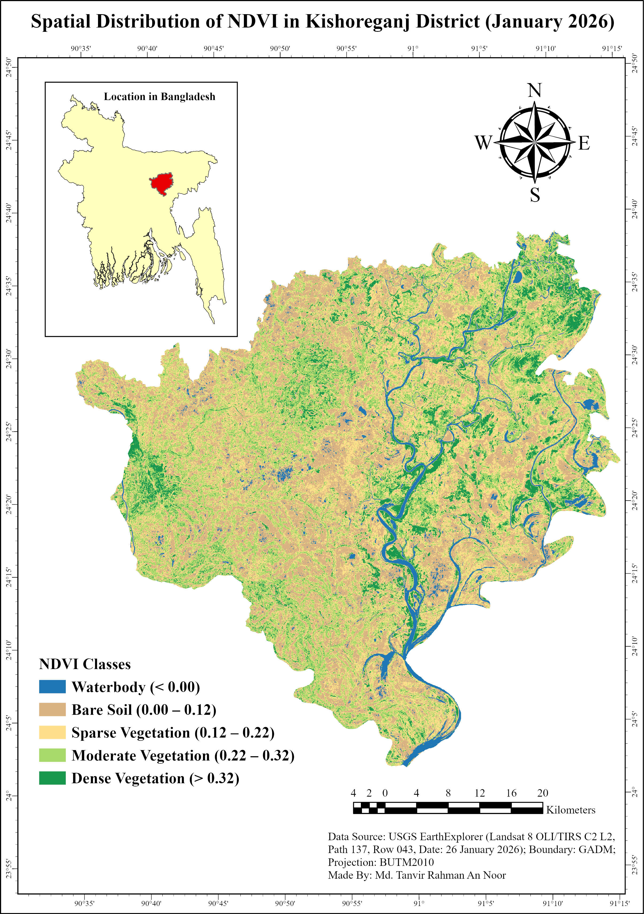

---

## 7. Geospatial Baseline Study Area Map of Kishoreganj District
* **Tools & Data:** ArcGIS Pro, Administrative Vector Layers
* **Summary:** Multi-frame study area map integrating vector boundaries, coordinate reference systems, and cartographic elements for agricultural research.
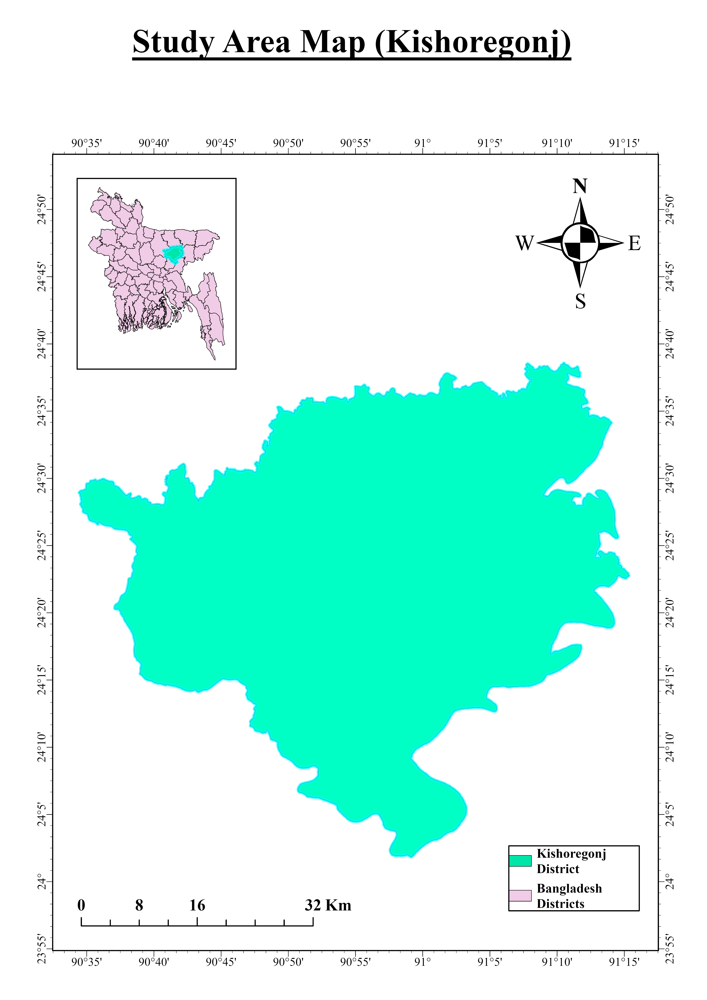

---

## 8. Sentinel-2 NDVI Mapping of Jashore District
* **Tools & Data:** Google Earth Engine (JavaScript API), QGIS, Sentinel-2 Imagery
* **Summary:** Regional vegetation density and environmental health assessment across Jashore District.
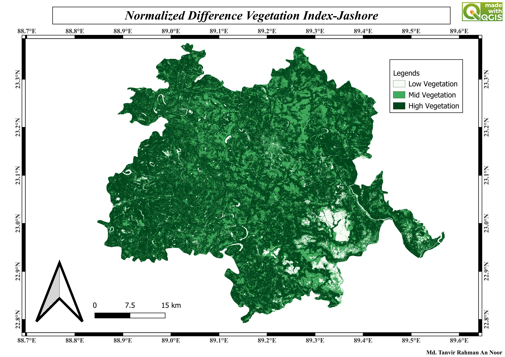

---

## 9. Multi-Criteria Overlay Analysis for Land Suitability
* **Tools & Data:** QGIS, Vector & Proximity Layers
* **Summary:** Spatial land suitability modeling based on road proximity, waterbody proximity, and protected area exclusion.
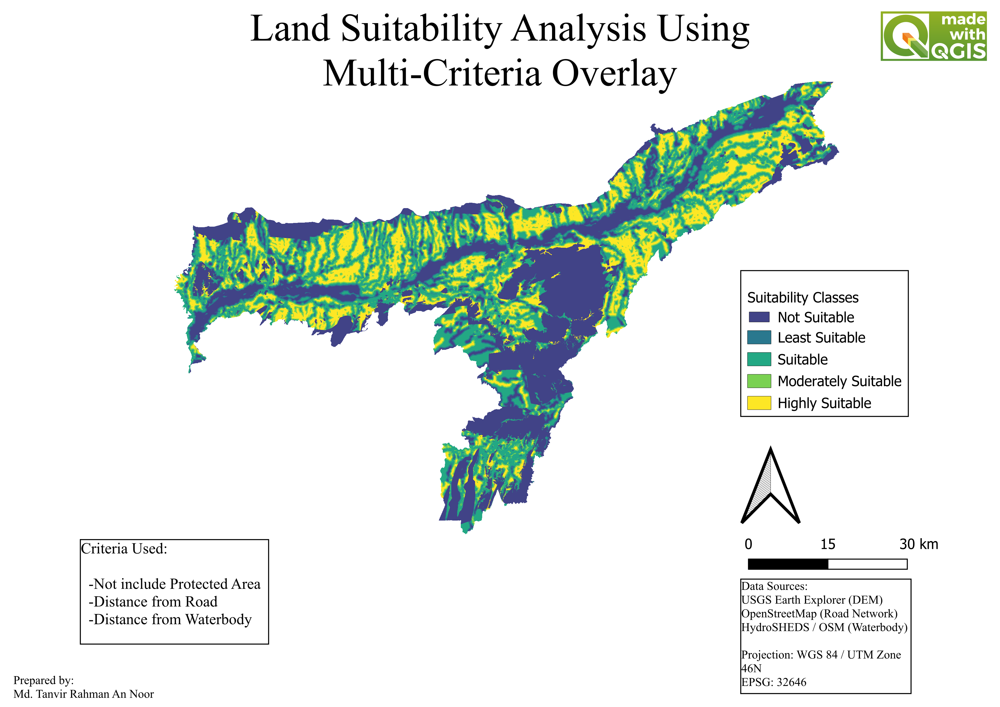

---

## 10. Historical Map Georeferencing (1882 Southern India Map)
* **Tools & Data:** QGIS, Historical Cartography
* **Summary:** Control-point georeferencing aligning an 1882 historical map of Southern India with modern spatial reference coordinates.
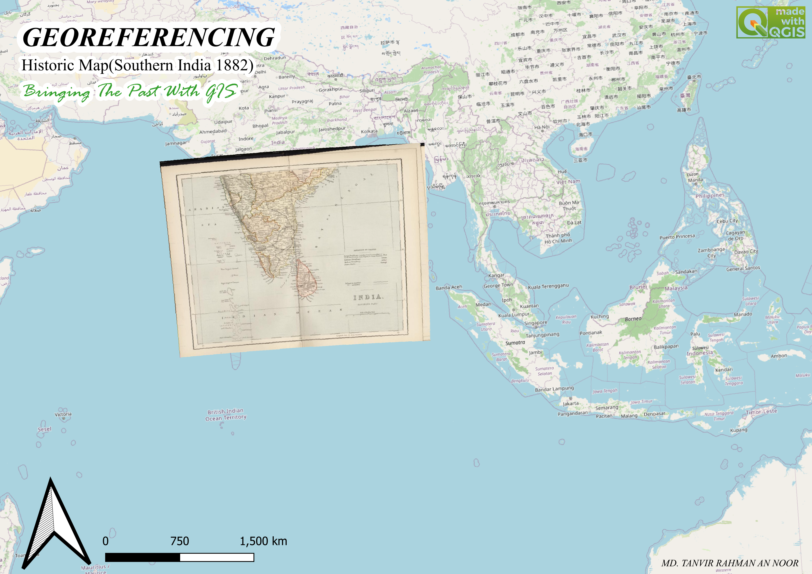

---

## 11. Regional NDVI Analysis (May 2020)
* **Tools & Data:** QGIS, Satellite Imagery
* **Summary:** Evaluated 2020 vegetation conditions and produced a thematic NDVI visualization for 10 May 2020.
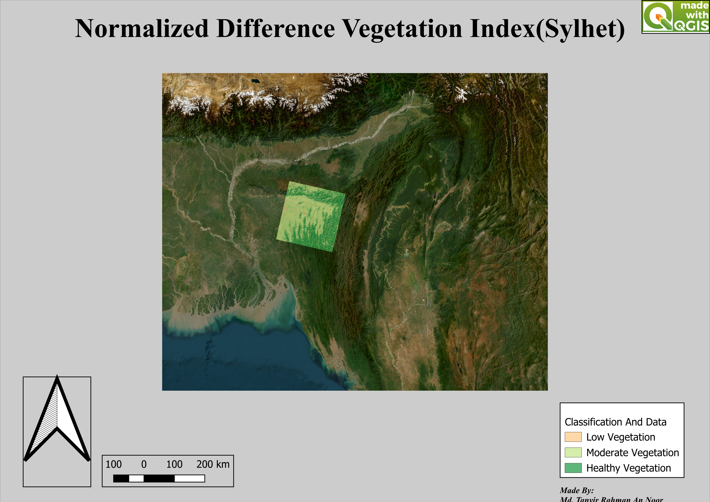

---

## 12. Global Population Density Change Map (2000–2010)
* **Tools & Data:** QGIS, Global Demographic Data
* **Summary:** Thematic visualization of global decadal population growth and decrease between 2000 and 2010.
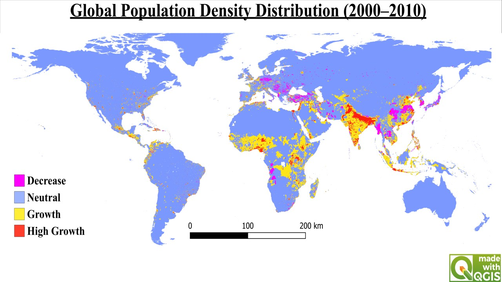

---

## 13. Upazila-Level Administrative Study Map of Jashore District
* **Tools & Data:** QGIS, Administrative Vector Boundaries
* **Summary:** Upazila-level administrative boundary layout of Jashore District, Bangladesh.
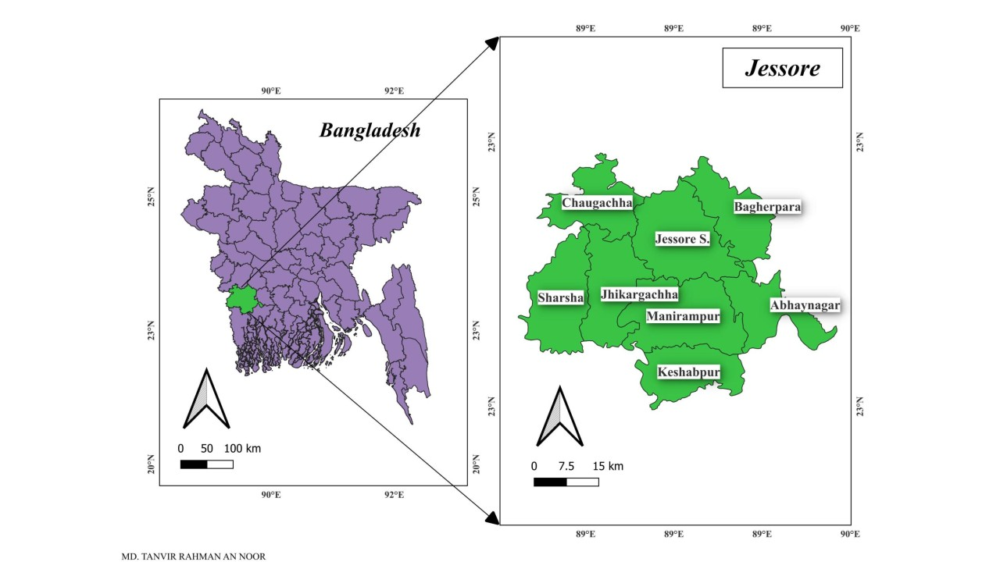
